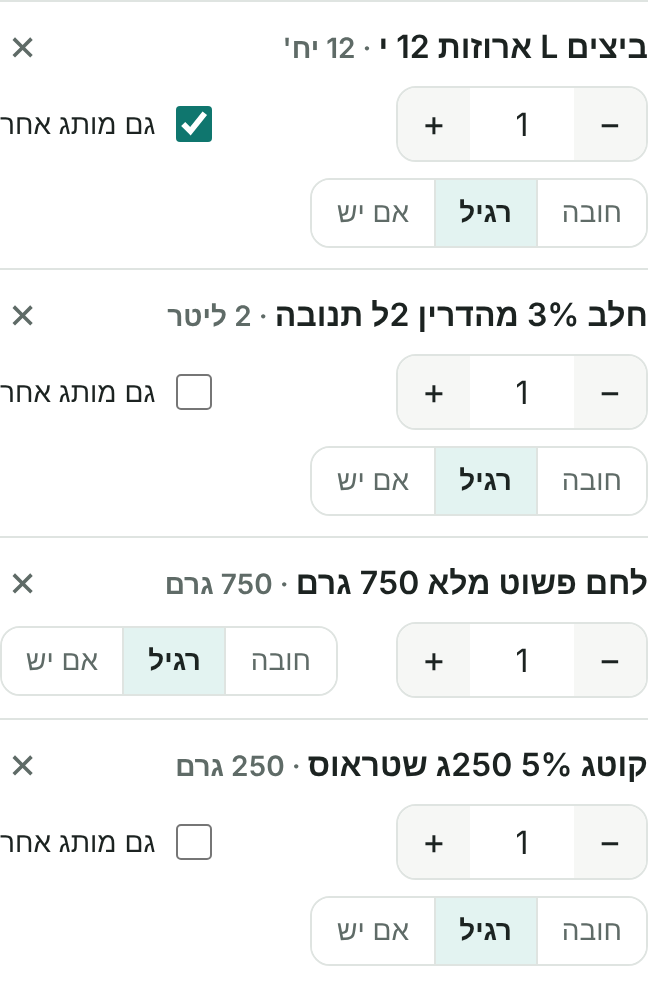
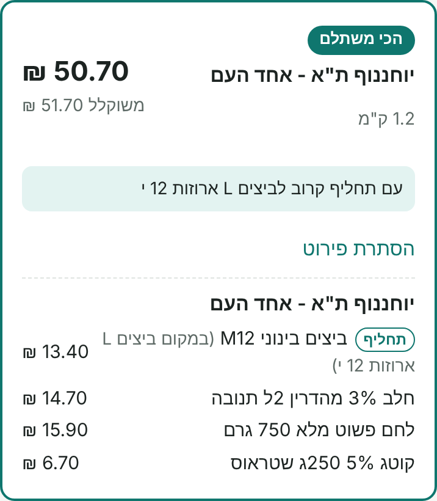

# Supermarket Prices IL

Find the cheapest nearby supermarket for your whole shopping basket in Israel.

**Live:** https://supermarket-prices-il.onrender.com (Tel Aviv; the free server sleeps when idle, so the first visit can take up to a minute)

<p>
  
  
</p>

Under Israel's food price transparency law, large supermarket chains publish the price of every product in every branch as XML files. The data is public but hard to use: each chain has its own portal and format. This project downloads those files daily, normalizes them into one PostgreSQL database, and (soon) serves a web app that compares a full basket across nearby branches.

## Status

Phase 1 (MVP) in progress: Tel Aviv, regular prices, no delivery. Four chains, 74 branches.

- [x] Repository skeleton
- [x] Ingest pipeline: download, parse, quality checks, load (74 Tel Aviv branches, about a minute)
- [x] Branch coordinates (all 74 branches; one address supplied by hand)
- [x] Scheduled daily run (`.github/workflows/ingest.yml`), active once a `DATABASE_URL` secret is set
- [x] Hosted Postgres (Neon), loaded by the daily run
- [x] Basket optimization engine (one or two stores, missing-item penalties)
- [x] API (Fastify) and web app (React + TypeScript, Hebrew, mobile-first)
- [x] Installable on phones (PWA); the shopping list opens without a connection
- [x] Public deployment (Render, from `render.yaml`)

## Stack

| Layer | Choice |
| --- | --- |
| Front end | React + TypeScript (mobile-first, Hebrew RTL) |
| Back end | Node.js + TypeScript |
| Database | PostgreSQL |
| Pipeline | TypeScript, scheduled daily |
| Tests | Vitest |

## Repository layout

```
db/migrations/      SQL schema migrations, applied in order
packages/pipeline/  Download, parse and load the chains' price files; geocode branches
packages/catalog/   Product categories and close substitutes: pure TypeScript, no I/O
packages/engine/    Basket optimization: pure TypeScript, no I/O
packages/api/       HTTP API (Fastify): product search, basket comparison, data freshness
apps/web/           Web app (React + Vite), Hebrew RTL, mobile-first
```

## Running locally

Requires Node 22+ and PostgreSQL 16.

```bash
npm install
cp .env.example .env    # then edit the connection strings
export $(cat .env | xargs)
npm run migrate -w @spil/pipeline
npm run ingest -w @spil/pipeline
npm test                # integration tests run when TEST_DATABASE_URL is set
npm run dev             # API on :3001 and the web app on :5173
```

End-to-end tests (Playwright, phone-sized Chromium) run the built app against a seeded database:

```bash
DATABASE_URL=<throwaway db> npm run e2e:seed -w @spil/web
npm run build
DATABASE_URL=<same db> npm run e2e -w @spil/web
```

A first run loads about 190,000 prices (49 MB). Later runs write only the prices that changed, and skip files already processed.

## Deploying

The whole site is one service: the API serves the built web app.

```bash
npm ci
npm run build   # builds apps/web into apps/web/dist
npm start       # API + web on $PORT (default 3001); needs DATABASE_URL
```

On Render, `render.yaml` describes the service: New → Blueprint → this repository, then paste the Neon connection string when asked for `DATABASE_URL`.

Or with Docker: `docker build -t supermarket-prices-il .` then run with `DATABASE_URL` set. The same image runs the daily ingest with `npm run ingest -w @spil/pipeline`.

## How a daily run works

The `Daily ingest` workflow runs every morning (and on demand from the Actions tab). It needs one repository secret, `DATABASE_URL`, pointing at the production Postgres; without it the workflow does nothing.


1. Download each chain's Stores file and keep the branches in the target cities.
2. For every branch, find its newest PriceFull file. Skip it if it was already processed, or if a newer file was.
3. Decode (gzip, UTF-8 or UTF-16), parse, and normalize units to grams, millilitres or units.
4. Quality checks: drop absurd prices, reject the file if too many lines are unusable or if the list shrank by more than half since the last good run (a cut-off download). A rejected file leaves the previous prices in place.
5. In one transaction: upsert products (barcoded products are shared across chains), close changed prices, open new ones.
6. Geocode branches that are new or whose address changed (Nominatim structured search, one request per second). A normal day makes no requests.

## Design notes

- **Store price changes, not snapshots.** `price_changes` keeps one row per price period (`valid_from` / `valid_to`). A daily run only writes rows for prices that changed, so the database stays small and price history comes for free.
- **Idempotent runs.** Every processed file is recorded in `ingest_runs`; re-running on the same file changes nothing.
- **One engine, two cost models.** Picking branches within a radius and splitting an online order across chains are the same problem: choose a set of stores, buy each item where it is cheapest, and add a fixed cost per store. Only the fixed cost differs (an extra stop vs. a delivery fee with a minimum order), so the engine takes a `CostModel`. Delivery is implemented and tested but not exposed yet.
- **Missing items are priced, not ignored.** Otherwise the "cheapest" store is the one with the most gaps. A missing item costs its highest price nearby plus one extra trip; a "must" item rules a store out; an "if available" item costs nothing.
- **Close substitutes, priced as whole packs.** 23 staple categories (eggs, milk, dairy, butter, fresh vegetables, pasta, rice, flour, tuna, oil, sugar, salt and more) are recognized by hand-written rules tested against real product names. When a store lacks the exact product, its best same-category product is used: enough whole packs to cover the amount (12 eggs from 18-packs means one 18-pack), plus a small ranking penalty (₪0.50, more for each attribute that differs, such as egg size or free-range). Some attributes are hard: lactose-free milk never replaces regular milk. Marking an item "any brand" lets the engine take a cheaper same-kind product even where the exact one is sold, with no base penalty.
- **Exhaustive search.** With up to 30 nearby stores and at most 2 stops there are 465 combinations, so the engine tries them all and the answer is exact.

## Known limitations

- Products are matched across chains by barcode, and by close substitutes only within the 23 staple categories. Other products with chain-internal codes cannot be compared yet; the search shows when a product is sold by one chain only.
- Regular prices only; promotions are not applied.
- Carrefour and Victory are not loaded yet: their portals only answer Israeli IP addresses.

## Data sources

Links and public usernames come from each chain's price-transparency page and the [Consumer Protection Authority](https://www.gov.il/he/pages/cpfta_prices_regulations).

| Chain | Tel Aviv branches | Portal | Access |
| --- | --- | --- | --- |
| Shufersal | 33 | prices.shufersal.co.il | Public |
| AM:PM (Dor Alon) | 31 | url.publishedprices.co.il | Public username, no password |
| Rami Levy | 6 | url.publishedprices.co.il | Public username, no password |
| Yochananof | 4 | url.publishedprices.co.il | Public username, no password |
| Carrefour | 23 | prices.carrefour.co.il | Public, Israeli IPs only |
| Victory | 8 | laibcatalog.co.il | Public, Israeli IPs only |

Branches are matched to the city by CBS locality code, by city name, or, when a chain leaves the city empty (Yochananof), by a hand-checked list of branch codes.
